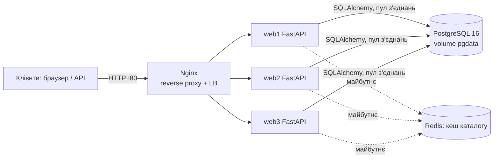

# Архітектура AidHub

## Вибір предметної області та обґрунтування

Обрано **платформу координації гуманітарної допомоги**. Це домен із чіткою
транзакційною проблемою: кілька фондів одночасно намагаються зарезервувати
обмежені запаси на складах. Тут природно проявляються теми всього курсу:
рівні ізоляції та блокування в РСУБД, рольовий доступ, кешування читання каталогу,
горизонтальне масштабування і навантажувальне тестування конкурентних записів.

## Схема

Модель даних: `funds` 1—N `users`; `warehouses` 1—N `pallets`;
`reservations` зв'язує `pallets` і `funds` (+ `user_id` — хто створив).

## Ключові рішення

| Рішення | Обґрунтування |
|---|---|
| FastAPI + SQLAlchemy 2 | Типізований API, залежності для RBAC, проста інтеграція з Pydantic-схемами |
| PostgreSQL | Потрібні ACID-транзакції, `SELECT … FOR UPDATE`, часткові унікальні індекси |
| Резервування: двошаровий захист | (1) `SELECT … FOR UPDATE` у порядку зростання id — серіалізує конкурентів і виключає взаємоблокування; (2) часткове унікальне обмеження `uq_reservation_active_pallet` у БД як страховка від помилок у коді |
| Атомарний запит на кілька палет | «все або нічого» — фонд не отримує частину замовлення |
| Песимістичне блокування замість optimistic | Висока контентність за малий набір палет: повторні спроби з version-колонкою марнували б роботу |
| JWT + httpOnly-cookie | Той самий механізм для API (Bearer) і сторінок; сервер без сесійного стану, тому репліки взаємозамінні |
| scrypt для паролів | Стійкий до GPU-перебору, є в стандартній бібліотеці; сталий хеш-«манекен» вирівнює час відповіді при невідомому email |
| Ролі `admin`/`user`, перевірка в залежностях | Вертикальний захист: `require_admin` на роутері `/admin`; горизонтальний: перевірка `fund_id` / `user.id` до пошуку об'єкта |
| Конфіг через env + pydantic-settings | Нуль секретів у коді; валідація при старті; production відхиляє DEBUG і слабкий ключ |
| Stateless-репліки за Nginx | Горизонтальне масштабування без «липких» сесій; advisory-lock серіалізує ініціалізацію схеми |
| Multi-stage Docker, non-root | Малий образ без компіляторів, мінімальні привілеї |

## Обмеження MVP та наступні кроки

* Схема створюється через `create_all`; для еволюції потрібен Alembic.
* Немає rate limiting на `/auth/login`, немає refresh-токенів і відкликання JWT.
* Кеш каталогу (Redis) і read-репліки БД — наступні роботи.
